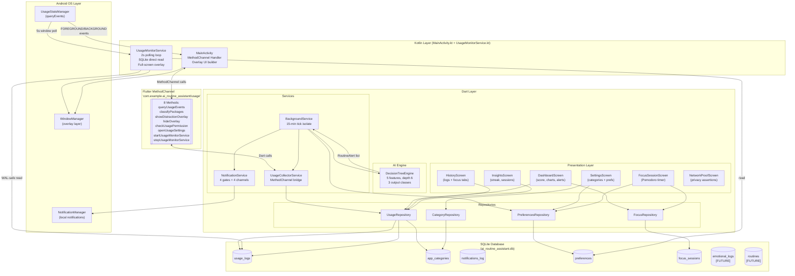
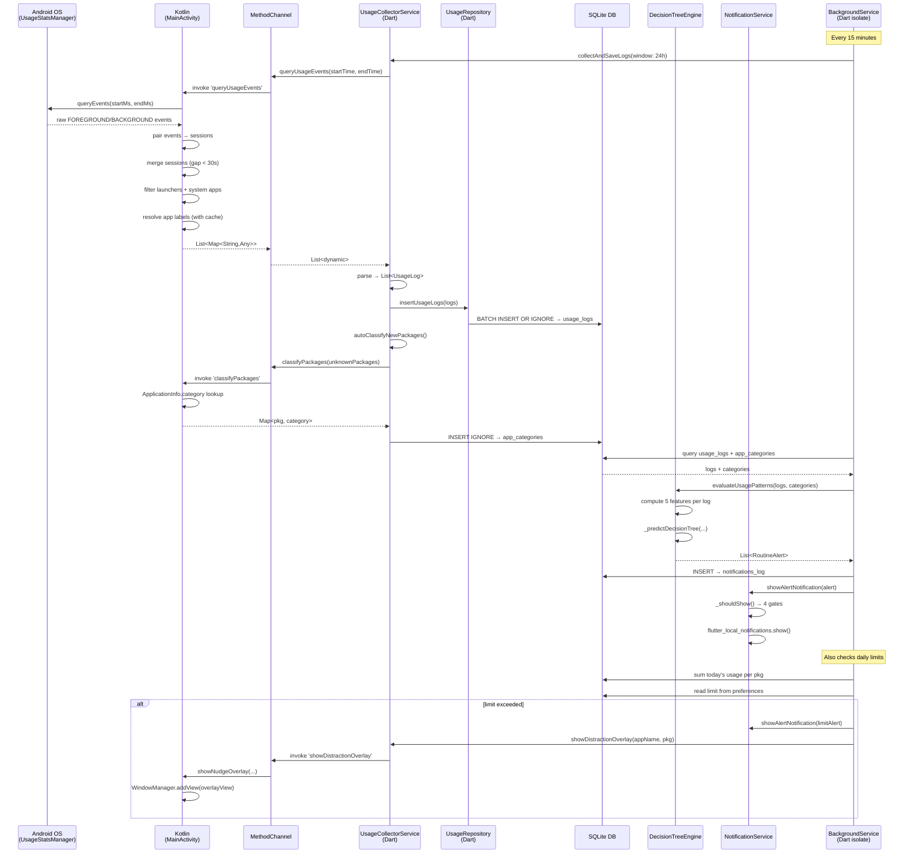
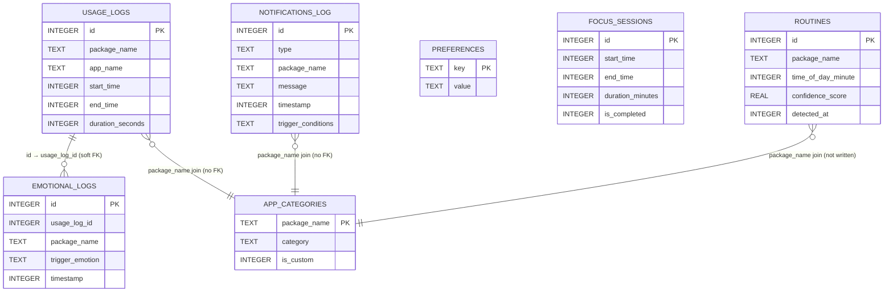

# 06 – Diagram Data (Mermaid)
**AI Routine Assistant** | Presentation Preparation Document

---

## Verified Facts (confirmed directly in code)

- All nodes and edges in these diagrams represent real components confirmed in the codebase
- MethodChannel name verified: `"com.example.ai_routine_assistant/usage"` (MainActivity.kt:31)
- Table names and column names verified in `AppDatabase._createDB()` (app_database.dart)
- Service names and class names match actual Kotlin/Dart source files
- No speculative or planned components are included unless labelled [FUTURE]

---

## Diagram 1 — System Architecture



---

## Diagram 2 — Data Flow



---

## Diagram 3 — Alert Trigger Flowchart

```mermaid
flowchart TD
    START([App foregrounded OR 15-min tick fires]) --> PATH{Which path?}

    PATH -->|"Native Kotlin 2-second poll"| KP1["checkForegroundApp()"]
    KP1 --> KP2{New foreground app?}
    KP2 -->|No| WAIT1([Wait 2s, repeat])
    KP2 -->|Yes| KP3["onAppForegrounded(pkg)"]
    KP3 --> KP4{Has launch intent?\n(not system/launcher)}
    KP4 -->|No| WAIT1
    KP4 -->|Yes| KP5["Read app_categories\nfrom SQLite"]
    KP5 --> KP6{"category ==\n'distracting'?"}
    KP6 -->|No| KP7["limitMins = pkg limit\nfrom preferences"]
    KP6 -->|Yes| KP8["limitMins = pkg limit\nOR category limit (120 min default)"]
    KP7 --> KP9{limitMins > 0?}
    KP8 --> KP9
    KP9 -->|No| WAIT1
    KP9 -->|Yes| KP10["SUM today usage\nfrom usage_logs"]
    KP10 --> KP11{usedMins >= limitMins?}
    KP11 -->|No| WAIT1
    KP11 -->|Yes| KP12["triggerAlert(pkg, appName, used, limit)"]
    KP12 --> KP13{Has SYSTEM_ALERT_WINDOW\npermission?}
    KP13 -->|Yes| KP14["showFullScreenOverlay(appName)\n(auto-dismiss 4s)"]
    KP13 -->|No| KP15
    KP14 --> KP15["showLimitNotification(pkg, appName)"]
    KP15 --> KP16{Within 1-min\ncooldown?}
    KP16 -->|Yes| DONE1([Done])
    KP16 -->|No| KP17["NotificationManager.notify()"]
    KP17 --> DONE1

    PATH -->|"Dart 15-min AI analysis"| DP1["collectAndSaveLogs()"]
    DP1 --> DP2["DecisionTreeEngine\n.evaluateUsagePatterns()"]
    DP2 --> DP3["_predictDecisionTree()\nfor each UsageLog"]
    DP3 --> DP4{Predicted class?}
    DP4 -->|"0 = No Alert"| DONE2([No action])
    DP4 -->|"1 = Distraction Alert"| DP5["RoutineAlert(distractionAlert)"]
    DP4 -->|"2 = Routine Reminder"| DP6["RoutineAlert(routineReminder)"]
    DP5 --> DP7["insertNotification() → notifications_log"]
    DP6 --> DP7
    DP7 --> DP8["NotificationService._shouldShow()"]
    DP8 --> GATE1{Type muted?}
    GATE1 -->|Yes| BLOCKED([Blocked])
    GATE1 -->|No| GATE2{Focus active?\n(distraction only)}
    GATE2 -->|Yes| BLOCKED
    GATE2 -->|No| GATE3{Quiet hours?}
    GATE3 -->|Yes| BLOCKED
    GATE3 -->|No| GATE4{Daily cap\nreached?}
    GATE4 -->|Yes| BLOCKED
    GATE4 -->|No| SEND["flutter_local_notifications.show()"]
    SEND --> DONE3([Notification sent])
```

---

## Diagram 4 — Database ER Diagram



> **Notes on diagram:**
> - All foreign key relationships are soft (no SQLite FK enforcement)
> - `ROUTINES` table: created, never written to — [FUTURE]
> - `EMOTIONAL_LOGS` table: created, DB method exists, UI not wired — [FUTURE]
> - `PREFERENCES` is standalone (no joins with other tables)
> - `FOCUS_SESSIONS` is standalone (queried independently by WeeklySummaryService)
